<p align="center">
  <picture>
    <source media="(max-width: 600px)" srcset="assets/hero-mobile.svg">
    
  </picture>
</p>

<p align="center">
  <a href="https://github.com/skip4570gov/hypergrok-trading-desk/releases"></a>
  <a href="https://www.npmjs.com/package/hypergrok-trading-desk"></a>
  <a href="LICENSE"></a>
  <a href="https://www.hypurr.co/ecosystem-projects/hypergrok"></a>
</p>

<p align="center">Works in <a href="#start">Grok Bot</a> · <a href="docs/hyperliquid-claude-code.md">Claude Code</a> · <a href="docs/hyperliquid-cursor.md">Cursor</a> · <a href="docs/hyperliquid-codex.md">Codex</a> · <a href="docs/hyperliquid-gemini-cli.md">Gemini CLI</a> · <a href="docs/hyperliquid-grok-build.md">Grok Build</a></p>

HyperGrok gives your AI agents a shared process for Hyperliquid research, risk, and review. This `paper-only` branch has six role profiles, seventeen skills, public info reads, and a local simulator. It cannot place a live order. Start with public market data, then set up the desk in Grok Bot or [your preferred agent tool](#also-runs-in-grok-build-cursor-claude-code-codex-and-gemini-cli).

## Try it now, no keys

```bash
git clone https://github.com/skip4570gov/hypergrok-trading-desk.git
git checkout 6ebafa835d1466df646dd1c7d5c5a8aaaaf0ee2c
cd hypergrok-trading-desk
python3 scripts/opening_bell.py --coin ETH
```

A live ETH snapshot from Hyperliquid's public `/info` endpoint: price, funding, open interest, spread and depth. It needs no wallet, account or key, and runs on Python 3's standard library.

<p align="center">
  
</p>

Recorded from the command above on 25 October 2026 at 13:09 UTC. The figures are a historical snapshot; run it yourself for current data.

## Start

For the paper desk, open Grok Bot and paste:

> Set up the HyperGrok trading desk from https://github.com/skip4570gov/hypergrok-trading-desk/blob/6ebafa835d1466df646dd1c7d5c5a8aaaaf0ee2c/skills/hypergrok-bootstrap/SKILL.md. Follow the bootstrap skill, use https://github.com/skip4570gov/hypergrok-trading-desk/blob/6ebafa835d1466df646dd1c7d5c5a8aaaaf0ee2c/SETUP.md for the complete runbook, and finish with its evidence receipt.

The Desk Lead runs Opening Bell, installs the shared skills, prepares the team and returns a setup receipt. Orders stay in the local simulator. Do not provision a key. See the [full setup runbook](SETUP.md).

<details>
<summary><strong>Opening Bell and desk doctor for scripts</strong></summary>

Opening Bell reports source and UTC time, mid/mark/oracle prices, 24-hour change and volume, hourly funding, open interest, spread and depth at 5/10/25 bps. It requests coarser book pages when twenty levels cannot cover a band, identifies each figure's source page and marks unreached depth as a floor. `scripts/desk_doctor.py` checks the release, roles, skill hashes, desk folders and public connectivity. Both use only Python's standard library.

For automation, inspect the offline `--schema`, then use `--json`. Failed reads, partial depth and doctor warnings remain explicit. Snapshots accept canonical mixed-case names and HIP-3 markets:

```bash
python3 scripts/opening_bell.py --schema
python3 scripts/opening_bell.py --coin xyz:TSLA --json
python3 scripts/desk_doctor.py --offline --json
```

Scripts do not accept another origin. HIP-3 discovery stays a public read. Orders stay in the simulator.

</details>

<details>
<summary><strong>Collect history you can check</strong></summary>

Before a backtest, collect the exact period into a research bundle:

```bash
python3 scripts/research_dataset.py --coin ETH --interval 4h \
  --start 2026-09-01T00:00:00Z --end 2026-10-01T00:00:00Z \
  --with-funding --output ../hypergrok-data/eth-september --json
python3 scripts/research_dataset.py --verify ../hypergrok-data/eth-september --json
```

The bundle keeps requests, captured responses, observed CSV rows and a hashed manifest. Closed UTC windows, explicit missing ranges and bounded funding pagination distinguish `complete`, `incomplete` and `unavailable` history. Offline verification replays the saved responses; it checks consistency, not source authenticity or strategy quality. The tool needs no key and never fills a gap with synthetic data. See [Research datasets](docs/RESEARCH_DATASETS.md) for the supported intervals, market selection, exit codes and analyst handoff.

</details>

## Meet the desk

You supply the ideas. Each role owns a stage and hands its evidence to the next.

| Bot | What they do for you |
| --- | --- |
| **Desk Lead** | Your main contact. Runs the floor, keeps every trade moving through the same clean process. |
| **Market Analyst** | Live Hyperliquid data on demand: price, depth, funding, open interest, candles. Timestamped and sourced. |
| **Research Analyst** | What is happening and what is scheduled: fundamentals, news, catalysts, onchain and social context. |
| **Strategist** | Turns your idea into explicit rules, backtests it honestly on public history, and proposes paper trades. |
| **Risk Manager** | Sizes every BTC or ETH idea on the $100 paper wallet, can say no, and is the only role that may run the simulator. |
| **Trade Reviewer** | Keeps the desk journal and grades every paper trade on process and outcome, separately. |

Five sit together on the **Trading Floor** group chat; the Trade Reviewer works by DM. There is no Execution Trader. Every paper trade follows the same path:

<p align="center">
  <picture>
    <source media="(max-width: 600px)" srcset="assets/desk-flow-mobile.svg">
    
  </picture>
</p>

## A day on the desk

**"Brief me on ETH."** The Market Analyst pulls mid, mark, funding, open interest, 24h volume and depth at 5/10/25 bps from the exchange, and posts a brief with sources and UTC times.

**"I want to long ETH at 3,000 with a trailing stop 100 below and a target at 3,200."** The Desk Lead opens a proposal. The Risk Manager checks the $100 wallet, the trailing stop, reward-to-risk, and the 1% cap, then returns a paper ticket. You type `approve` plus that ticket id. The Risk Manager runs `scripts/paper_sim.py submit` once. The Trade Reviewer records the journal line.

<p align="center">
  
</p>

**"Can we test whether funding extremes mean-revert?"** The Strategist writes the rules with you, collects and verifies the agreed history, then reports costs, funding assumptions, holdout results and the trade distribution. Missing history stays visible. A forward test uses the local simulator and the same ticket process.

**"Watch ETH and tell me if funding flips negative."** A routine polls the public info feed and pings you when it happens.

## What the desk knows

Seventeen skills, in the portable `SKILL.md` format, shared by all your Bots.

**Bootstrap** - pinned release install, Opening Bell, team construction, desk doctor and a receipt that distinguishes what happened from what still needs a manual step.

**Hyperliquid** - public info reads, the local paper simulator, and a reference that does not include a signing scheme.

**Desk** - how the team works: operating model, the trade lifecycle and ticket, risk limits and sizing arithmetic, the execution protocol, monitoring and routines, post-trade review, incident playbooks, and the strategy lab.

## Other agent setups

HyperGrok is for a coordinated Hyperliquid desk in Grok Bot. For a different setup, these Galleon projects can help:

- [Boomkin](https://github.com/galleonlabs/boomkin#get-started) sets up a native Hermes DeFi profile with modular skill packs and official tool connections.
- [crypto-defi-skills](https://github.com/galleonlabs/crypto-defi-skills#install-only-what-you-need) lets you add individual workflows to an existing agent: lending, liquidity provision, routing, portfolio review and more.

Neither is required to use HyperGrok. Installing instructions does not connect a wallet or authorize a trade.

## Quote file

`scripts/market_data.py` exposes one read-only method, `PriceFeed.quote(symbol)`. `config/paper.json` chooses the source. `price_source: "hyperliquid"` posts only to `https://api.hyperliquid.xyz/info`. `price_source: "file"` reads a local JSON file at `quotes_file`. An outside process writes that file. This repository does not call Robinhood and contains no Robinhood credential, SDK, or order client. If the file cannot supply a fresh BTC or ETH quote, the public info feed is the fallback. Another symbol is rejected and does not fall back.

The file is one object or an array of objects:

```json
{
  "symbol": "BTC",
  "bid": "100000.00",
  "ask": "100010.00",
  "mark": "100005.00",
  "source": "robinhood",
  "fetched_at": "2026-11-08T00:20:00Z"
}
```

`symbol` is `BTC` or `ETH`. `source` is `robinhood`. `bid`, `ask`, and `mark` are positive decimals and `bid` is not above `ask`. `fetched_at` is timezone-aware ISO8601. A quote older than `max_quote_age_seconds` (default 300) is rejected, as is a missing field or a timestamp more than 30 seconds in the future.

## Paper simulator

`scripts/paper_sim.py` is the only order command. The wallet is $100. It accepts BTC and ETH only, requires a trailing stop, requires reward-to-risk of at least 2:1, and rejects risk over 1% of equity including open paper risk. The journal is append-only. See [REVERT.md](REVERT.md) to return to `main` or commit `01c2a46`.

## Trading controls

- **You approve every paper trade**, by ticket id, after seeing the exact order. The simulator still enforces its rules after that approval.
- **No key is read.** This checkout has no private-key path and no exchange writer.
- **Sized on a stressed stop.** The desk includes assumed adverse stop fills and taker fees on both legs when sizing. Actual losses can exceed that assumption. [See what a stop costs](docs/STOP_COST.md).
- **Ceilings you cannot trade through.** Your limits file may only tighten the desk's own caps, never loosen them.
- **Paper only.** The simulator is the order path. Do not provision a key.
- **One writer.** Six Bots read; one Bot sends, once per approval, and reconciles by client order id.
- **Separate process and outcome.** The Trade Reviewer records both in a journal you can read.

Perpetual futures can liquidate an account. HyperGrok is documentation and instructions, not financial advice.

## Also runs in Grok Build, Cursor, Claude Code, Codex and Gemini CLI

Choose the guide for your runtime. Each uses the same skills and ticket process; support for roles, rules and hooks differs.

| Runtime | Setup | Roles and controls |
| --- | --- | --- |
| Claude Code | [Install from the plugin marketplace](docs/hyperliquid-claude-code.md) | Seven subagents and an exchange-write confirmation hook; load the operating model explicitly |
| Cursor | [Open the pinned checkout and enable the plugin](docs/hyperliquid-cursor.md) | Seven role profiles and desk rules; no Claude Code hook |
| Grok Build | [Install the pinned release](docs/hyperliquid-grok-build.md) | Skills and agent directories; rule loading is unverified |
| Codex | [Install from the Codex marketplace](docs/hyperliquid-codex.md) | Skills, with the seven roles run as labelled passes |
| Gemini CLI | [Install the extension](docs/hyperliquid-gemini-cli.md) | Skills and `GEMINI.md`, with roles run as labelled passes |

The Claude Code hook denies a command that looks like an exchange write. Cursor does not load that hook. This checkout has no order for a hook to approve. See [SECURITY.md](SECURITY.md).

The same pack installs as a skill:

```
npm exec --package=skills@1.5.23 -- skills add skip4570gov/hypergrok-trading-desk
```

The complete resources also install from npm:

```bash
npm install --save-exact --ignore-scripts hypergrok-trading-desk@1.7.1
python3 node_modules/hypergrok-trading-desk/scripts/desk_doctor.py --offline
```

The package contains the instructions, role profiles, plugin manifests and read-only Python tools. It has no JavaScript entry point, runtime dependencies or install hooks; installation does not start a desk or connect a wallet.

Live listings: [HypurrCollective ecosystem map](https://www.hypurr.co/ecosystem-projects/hypergrok) · [skills.sh](https://www.skills.sh/skip4570gov/hypergrok-trading-desk) · [cursor.directory](https://cursor.directory/plugins/hypergrok) · [botdirectory.ai](https://botdirectory.ai/bots/hypergrok-trading-desk)

After installation, load `desk-operating-model` using the command or context mechanism in your runtime guide.

## Inside the repository

```
SETUP.md     what your Grok Bot follows to build the desk
agents/      seven roles: Bot profile card + full system prompt
skills/      seventeen skills (bootstrap, hyperliquid-*, desk-*)
template/    exact public Grok Bot profile and skill hashes
scripts/     zero-key market, history, stop-cost and every-DEX account reads, offline verification, release checks
docs/        how it works, FAQ, install pages, stop cost, account read, provenance
assets/      the mascot, logo, README graphics and their generator
```

| Doc | |
| --- | --- |
| [How the desk works](docs/ARCHITECTURE.md) | roles, files, trust boundaries |
| [FAQ](docs/FAQ.md) | keys, approvals, testnet, customising the team |
| [Research datasets](docs/RESEARCH_DATASETS.md) | collect, verify and hand off historical evidence |
| [Stop cost](docs/STOP_COST.md) | what a triggered stop costs, from the live book |
| [Account read](docs/ACCOUNT_READ.md) | positions and equity across the main DEX, every HIP-3 DEX and spot |
| [Skills index](skills/README.md) | every skill and who uses it |
| [Grok Bot template](docs/GROK_BOT_TEMPLATE.md) | public profile, publish contract and clean-install evaluation |
| [Provenance](docs/PROVENANCE.md) | sources and licences |
| [Contributing](CONTRIBUTING.md) · [Security](SECURITY.md) · [Changelog](CHANGELOG.md) | |

## Get help and keep up

- **Updates:** use GitHub's **Watch → Custom → Releases** to follow [new releases](https://github.com/skip4570gov/hypergrok-trading-desk/releases).
- **Setup help:** check the [FAQ](docs/FAQ.md), then ask in [Discussions](https://github.com/skip4570gov/hypergrok-trading-desk/discussions). Share your runtime, release and failing command; keep keys and private account details out.
- **Bugs:** [open an issue](https://github.com/skip4570gov/hypergrok-trading-desk/issues/new/choose) with a reproduction and sanitized output. Follow the [community guidelines](CODE_OF_CONDUCT.md).
- **Contribute:** see [Contributing](CONTRIBUTING.md), the [fork review](docs/FORK_REVIEW.md) and [security policy](SECURITY.md). Share reproducible fixes and source-backed documentation improvements.

## License and credit

[MIT licensed](LICENSE), with the copyright and permission notice retained when reusing copies or substantial portions. Created by [Andrew Wilkinson](https://andrewwilkinson.io) and [Galleon Labs](https://github.com/galleonlabs).

See [reuse and attribution](ATTRIBUTION.md) for a ready-to-copy credit line. If HyperGrok Trading Desk helps your work, [a star on the original repository](https://github.com/skip4570gov/hypergrok-trading-desk) is appreciated and entirely optional.

HyperGrok has no token and will not launch one. [Read the FAQ](docs/FAQ.md#token).
